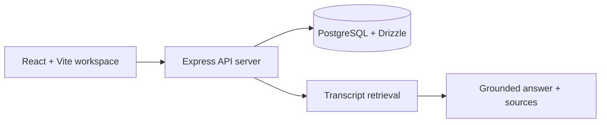

# AI Meeting Copilot..

Turn every meeting into searchable knowledge and actionable work.

AI Meeting Copilot is a portfolio-grade meeting intelligence workspace. It keeps meeting records, transcripts, decisions, and follow-through in one searchable place, then answers questions using transcript-backed sources.

## Current product slice.

- Workspace overview with activity, meeting counts, deadlines, and decisions
- Meeting library with search and status filtering
- Create, view, process, and delete meeting records
- Deterministic demo processing that stores transcript segments, decisions, and action items in PostgreSQL
- Transcript and analysis views on each meeting
- Action-item filters and completion updates
- Keyword/semantic-style search over stored transcript segments
- Grounded Ask Copilot answers with meeting, speaker, and timestamp sources
- Responsive UI with loading, error, and empty states

## Architecture.



The shared OpenAPI contract in `lib/api-spec/openapi.yaml` generates typed React Query hooks and Zod schemas. The frontend never calls the database directly.

## Running locally.

```bash
pnpm install
pnpm --filter @workspace/api-server run dev
```

The web app is run by the managed workflow:

```bash
pnpm --filter @workspace/ai-meeting-copilot run dev
```

Useful checks:

```bash
pnpm run typecheck
pnpm --filter @workspace/ai-meeting-copilot run typecheck
PORT=22506 BASE_PATH=/ pnpm --filter @workspace/ai-meeting-copilot run build
```

## Data model.

The development database includes `meetings`, `transcript_segments`, `decisions`, and `action_items`. The seeded `Client X Product Discussion` meeting demonstrates the complete knowledge flow without requiring paid AI APIs.

## Next phases.

The next implementation phases can add authenticated workspaces, private audio storage, transcription-provider adapters, structured LLM analysis, embeddings with pgvector, Supabase Realtime status updates, and an integration test suite. Demo processing is intentionally isolated so those providers can be added without changing the UI contract.
